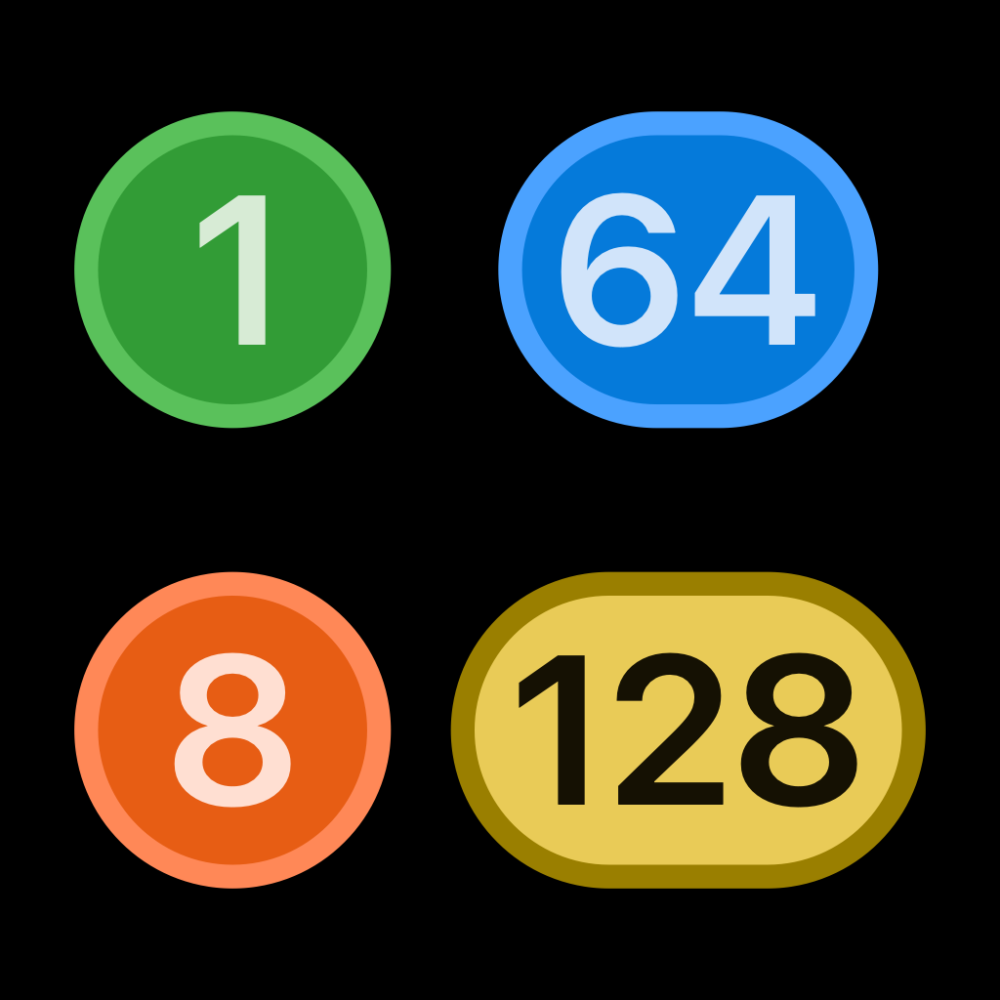
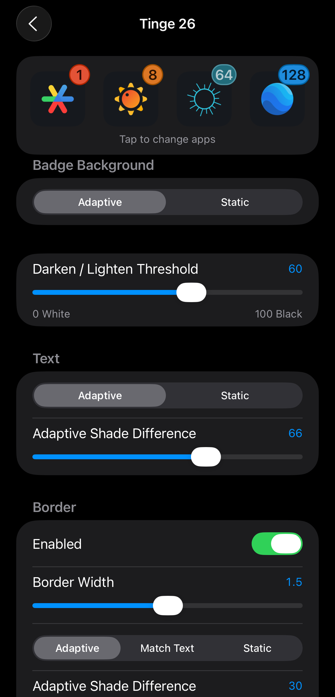

# Tinge 26

Tinge 26 customizes Home Screen notification badges on iOS 26. Match badge colors to each app icon or choose your own, then fine-tune the text contrast and border with a live preview.

[Download Tinge 26 v1.0.3](https://github.com/sahinkaa/Tinge26/releases/tag/v1.0.3)

## Live preview

The preview shows four installed apps with badge counts of **1, 8, 64 and 128**. Tap an icon to try another app. Adjustments appear immediately in the preview.

## Features

- Adaptive badge backgrounds use colors from rendered app icons, including themed icons.
- Set text and border colors separately. Borders can adapt, match the text or use a static color.
- Choose the darkness threshold for lightening or darkening adaptive text and borders.
- Adjust adaptive shade differences for text and borders independently. Set the border width to zero for a borderless badge.
- Folder badges use the color of the eligible app with the highest badge count.

## Install

- **RootHide:** Install the `iphoneos-arm64e` package directly, without Patcher.
- **Standard rootless:** Install the `iphoneos-arm64` package.

Respring and open **Settings → Tinge 26**. Changing the main Enabled switch requires a respring.

PreferenceLoader, a Substrate-compatible loader and libcolorpicker are required. RootHide also requires rootless-compat for the original compatibility core. Keep both **Tinge** and **ZZTingeAdaptiveBridge** enabled for SpringBoard.

## Credits

Original Tinge by **P2KDev (@p2kdev)**. Tinge 26 by **sahinkaa**. The icon sampling approach was informed by [w1tu’s ntfy](https://github.com/w1tu/ntfy).
